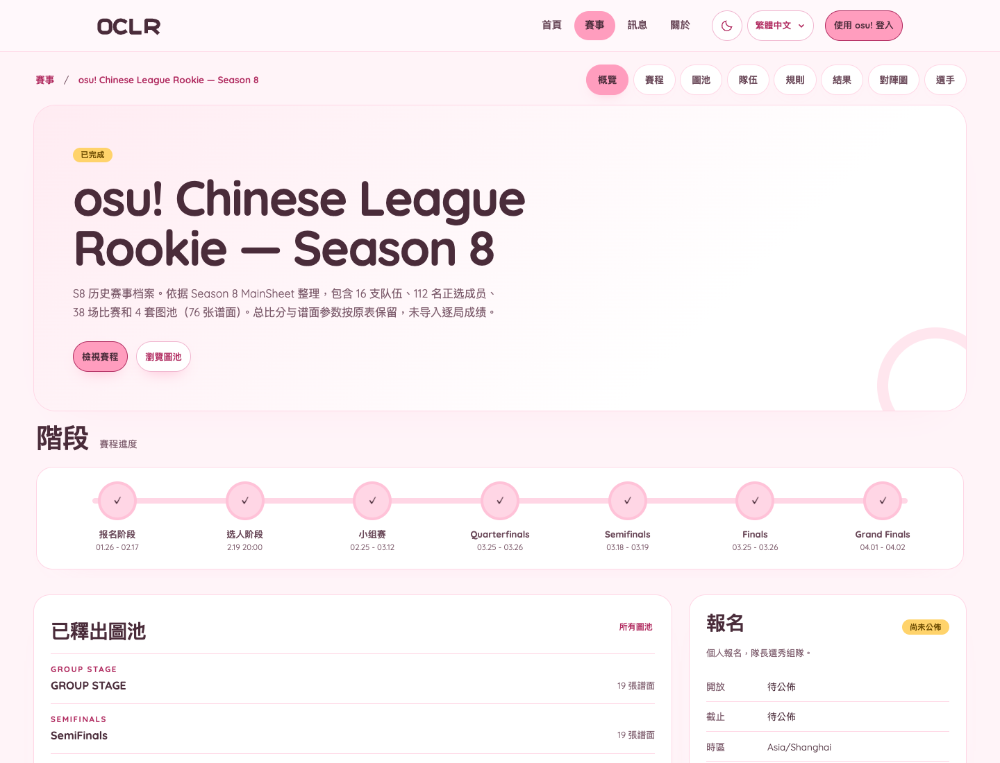
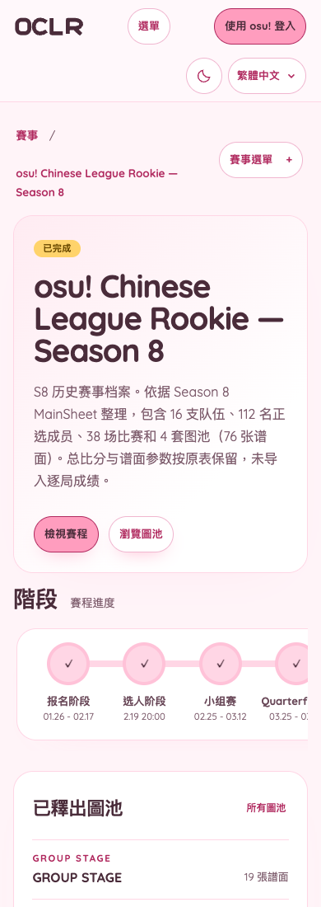
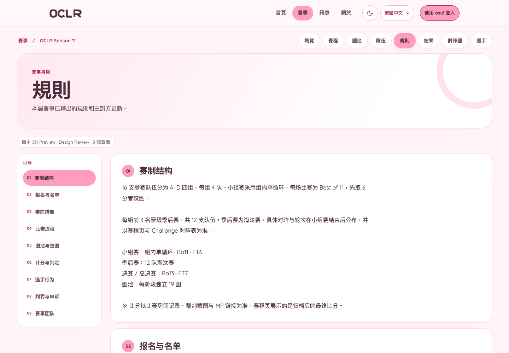
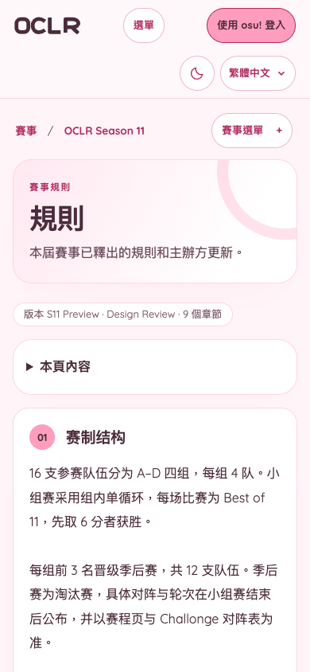
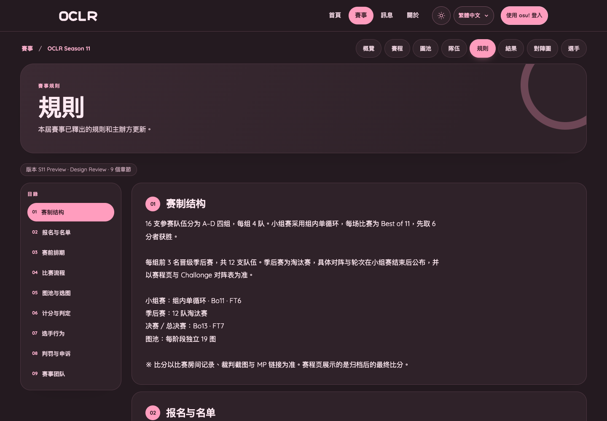
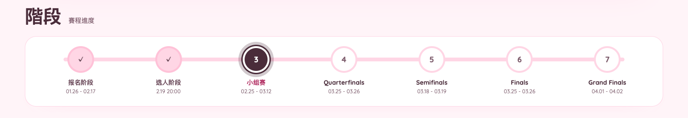

# Cute pastel public UI · design branch

Reference supplied by the organizer as `osu! Cup 賽事官網.html` (a local prototype, not committed). This branch applies that soft pastel language to the public OCLR website while keeping the existing database, routes, permissions and rule releases authoritative.

| Overview, desktop | Overview, mobile |
| --- | --- |
|  |  |

| Rules, desktop | Rules, mobile | Rules, dark |
| --- | --- | --- |
|  |  |  |

The overview screenshot uses the published S8 archive, which is completed, so every stage has a pale-pink check. A live edition shows its current stage as the dark dot with a halo; an upcoming edition starts with blank white dots. The state illustration below overrides the classes only for design review (completed / current / upcoming); it is not S8 status data. The rules screenshots use a disposable local preview database with the S11 rulebook as example content. They are references for the visual direction, not a new rules release or a claim about S11 dates.

## Scope

- Public routes only: site header/footer, home, tournament index, tournament overview, schedule, mappools, teams, rules, results, bracket, players and public profiles.
- Admin, Player/Captain workspaces and the broadcast overlay keep the existing lavender/workspace theme. The experiment intentionally does not reskin private tools yet.
- No content, result, registration, mappool or rules data is changed. The rules page continues to render the edition's published `rules.sections` from PostgreSQL.

## Visual language

- Paper `#fff4f8`, white surfaces, rose-pink borders and dark cocoa text.
- Pill navigation, 24–32px rounded cards, soft pink shadows and a single decorative ring per page band.
- Pastel yellow status chips; pink primary actions with dark text for contrast.
- Light and dark variants share the same tokens. Dark uses a warm mauve paper rather than the old navy workspace palette.
- Rules chapter cards pair a pink numbered bubble with the published heading/body text. The desktop index and mobile “On this page” disclosure, deep links and scroll-spy behavior are unchanged.
- Tournament stages render as one connected row: numbered circles joined by a pale line, with the stage name and date below. Completed stages use a pale-pink fill and a check; the current stage uses the strongest foreground/background contrast with a halo; upcoming stages are blank with a soft outline. On narrow screens the row scrolls horizontally inside a focusable region rather than wrapping.

## Fonts

`public/fonts/quicksand-latin-variable.woff2` is the Latin variable subset of [Quicksand](https://github.com/andrew-paglinawan/QuicksandFamily), licensed under the SIL Open Font License 1.1 (`Quicksand-OFL.txt`). It is applied only inside `.public-site`; Chinese text falls back to the platform's system CJK font. No remote font, image or UI-library request is added.

## Files

- `src/app/public-pastel.css` — scoped public token/component layer, loaded after the shared styles.
- `src/app/layout.tsx` — imports the layer once.
- `src/app/tournaments/[edition]/rules/page.tsx` — adds the existing translated rules eyebrow/summary to the page band.
- `src/app/tournaments/[edition]/page.tsx` — moves the status badge above the title so status is separate from registration actions.
- `src/components/milestone-stages.tsx` — reference-style connected stage tracker.
- `src/lib/milestone-state.ts` — date/status derivation for completed, current and upcoming stages.
- `tests/unit/milestone-state.test.ts` — completed/current/upcoming derivation cases.

## Data boundary

The S11 rulebook under `mainsheet/js/rules.js` is a preview/structure example, not an approved public rule release. It was used only in a disposable local preview database for visual review and is not seeded, committed or published by this branch. Real rules still require the organizer's normal Admin release and version consent flow.

## Verification

- `npm run check` and `npm run build` pass with `HOME` pointed at a writable directory.
- `npm test` has unrelated environment failures in `health.test.ts` (a stale local `.oclr-release` marker) and `update-script.test.ts` (sandbox signal handling); the rules/public-navigation/edition/i18n units pass.
- The existing `tests/e2e/mainsheet-light.spec.ts` desktop run passes against an isolated PostgreSQL database with Chrome, including axe WCAG 2A/2AA checks and 320–1440px overflow checks.
- Additional axe runs on public home, overview, schedule, mappools, teams and rules pages pass in light, dark, desktop and 390px mobile, in English and Traditional Chinese.
- Screenshots were reviewed at 1440×1000 and 390×844. Release/push is not performed from this branch; the repository credentials available in this environment cannot authenticate to GitHub.
