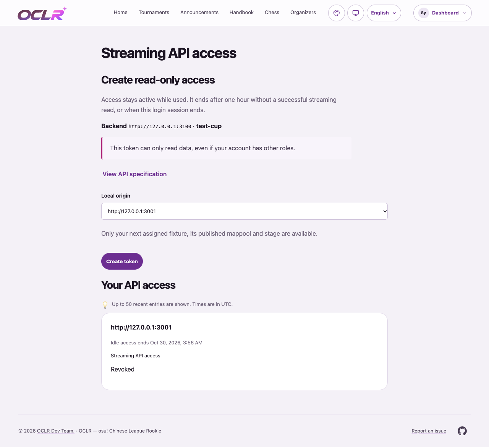
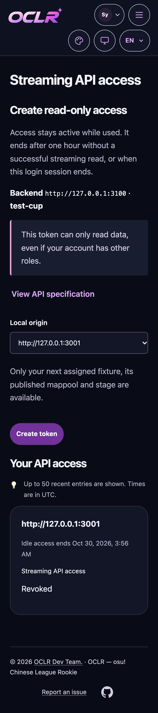

# #540 verification — 2026-10-30

Implemented on `codex/540-streaming-api`, based on
`10a4632f80ee53bf9a089c5b3877de494d26078b`. Final commit and exact-SHA CI status
are recorded on [#540](https://github.com/OCLR-dev/OCLR-website/issues/540).
Node 24.22.2, npm lockfile, local PostgreSQL 17 and Chrome channel were used.
All database work used dedicated `oclr_540_test`, `oclr_540_browser_test` and
`oclr_540_baseline_test` databases on a separate loopback PostgreSQL instance.
No existing preview process, production service or private environment file was used.

## Delivered behavior

- Edition-bound Streamer credential, independent of Developer and write roles.
- One-hour **idle** lease capped by the original login session. Successful GETs
  renew; HEAD, OPTIONS and failed reads do not. Updates coalesce by minute.
- One repeatable-read fixture/stage/explicit-pool projection, shared verbatim with
  the new subject-bound Developer resource. Saved referee completion and approved
  unpublished results are excluded without returning private result details.
- Same-origin credential management page, three locales, independent exact-origin
  CORS, generated 1.4.0 read contract, OpenAPI and integration guide.
- Overlay source is unchanged, as requested pending its upstream update.

## Local results

| Check                                               | Actual result                                                                                                                                                                                                                         |
| --------------------------------------------------- | ------------------------------------------------------------------------------------------------------------------------------------------------------------------------------------------------------------------------------------- |
| `npm ci`                                            | Passed with the existing lockfile                                                                                                                                                                                                     |
| `npm run check`                                     | Passed (lint and TypeScript)                                                                                                                                                                                                          |
| `npm run build`                                     | Passed                                                                                                                                                                                                                                |
| `npm test`                                          | Initial full run: 211 files passed, 2 failed; 1,748 tests passed, 2 failed, 1 skipped. Both failures were new test fixtures: missing result parent row and missing explicit Streamer grant. Fixed as described below.                 |
| Affected integration/contract reruns                | `streaming-api.test.ts`: 15/15 passed, including added concurrency and referee-completion cases. `extended-read.test.ts` and `read-api-dx.test.ts`: 6/6 passed. The full suite was not redundantly rerun after test-only corrections. |
| New migration upgrade test                          | 1/1 passed: upgrade from 0060, repeated migration, preserved sessions/grants/Developer credentials, idle-lease/scope constraints and logout cascade. Existing migration suite also passed in the full run.                            |
| `npm run i18n:extract` / `npm run test:i18n`        | Catalogs synchronized; 4/4 passed                                                                                                                                                                                                     |
| Generated schemas/OpenAPI/remote inventory          | Regenerated and drift checks passed                                                                                                                                                                                                   |
| `npm audit --omit=dev`                              | 0 vulnerabilities                                                                                                                                                                                                                     |
| Streaming, Developer API and read API browser specs | 8/8 desktop/mobile passed, including real browser CORS for existing reads; new credential issuance/read/revocation and 320px layout passed.                                                                                           |
| Full desktop/mobile attempt                         | 940 selected; stopped at 5 failures: 14 passed, 5 failed, 921 not run. Full regression is **not passed**.                                                                                                                             |
| Unmodified base comparison                          | All 5 failures reproduced on clean base `10a4632f`, separately installed/built against a separate database (see below).                                                                                                               |
| `git diff --check`                                  | Passed                                                                                                                                                                                                                                |

Test-fixture corrections preserved product authorization and
constraints: fixture assignments use the real `staff` source and timezone;
approved revisions require a match-result parent; full-site Developer parity
requires an explicit Streamer grant. The referee completion test uses the real
selection event ID as the initial attempt ID. No product guard was weakened.

## Existing full-regression failures

These exact cases also fail on the unmodified base:

1. `admin-navigation.spec.ts:12`: tournament return control reaches 1026px at a
   1024px viewport.
2. `admin-polish.spec.ts:200`: existing staff/settings layout overflows.
3. `application-profile.spec.ts:82`: existing profile layout overflows.
4. `archive-artwork.spec.ts:11`: 8 image failures exceed the assertion's limit of 6.
5. `archive-map-metadata.spec.ts:10`: expected Source link is missing.

The base's existing CI run
[40961724668](https://github.com/OCLR-dev/OCLR-website/actions/runs/40961724668)
also has failed core E2E, with verify/build/remote-E2E successful; this is historical
base evidence, not a result for the #540 commit. #538 tracks separate existing
core browser failures. No unrelated UI/test fixes are included in this issue.

## Visual inspection

Desktop/light and 320px mobile/dark were inspected; both themes also ran in the
browser case. Screenshots contain only synthetic identity and **revoked** access
metadata. Tokens were hidden before capture; the credential spec disables traces
and automatic failure screenshots to avoid capturing credentials.

## Remaining acceptance

New Chinese wording needs organizer review. Formal deployment/migration and real
Streamer/Overlay/OBS use were not performed. Full desktop/mobile regression and
the full-site remote matrix have no pass claim. The issue remains open for review.

## PR review follow-up — 2026-10-30

PR [#541](https://github.com/OCLR-dev/OCLR-website/pull/541) was reviewed for
Streamer/session/scope boundaries, exact fixture-pool projection, publication,
idle renewal, migration constraints and credential handling. The copied Developer
API empty-state wording was corrected in all three locales. Main `72f40d54` was
merged into the feature branch, preserving both sides of the locale conflicts.
No Overlay changes, merge to main or deployment were performed.

CI [40995169140](https://github.com/OCLR-dev/OCLR-website/actions/runs/40995169140)
on `afb94562` passed verify (including the complete unit/integration suite), build
and remote-e2e. Both core browser shards failed in desktop-auth and draft; the
newly integrated main contains #539's fixes to those tests. This does not establish
a passing run for the updated PR head. New CI results must be reported separately.

After resolving the merge and correcting the empty state, `npm run check`,
`npm run test:i18n` (4/4) and `git diff --check` passed locally.
