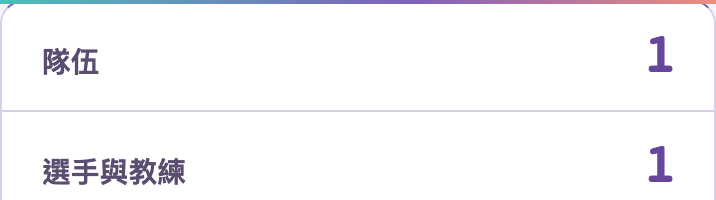
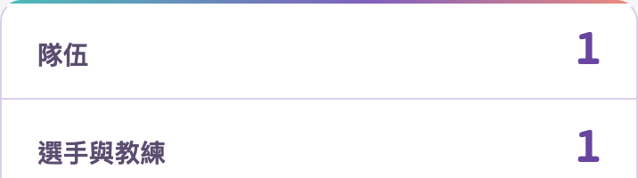
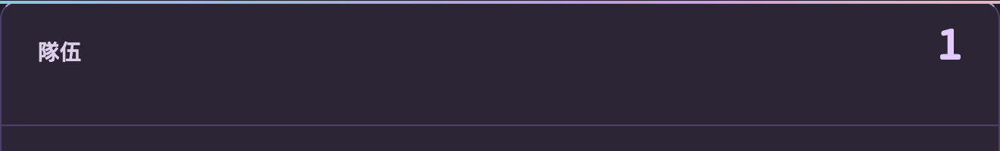
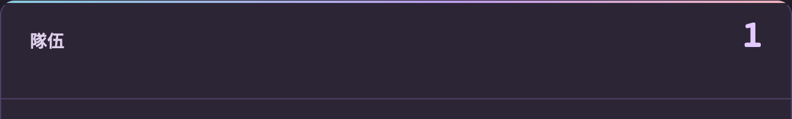

# S1 statistic-panel accent line

2026-10-29 Asia/Taipei. Follow-up to Chromatic Origins (#417), based on main `5032b947814fbcfc7315894639ede81c36fe013b`, alongside the S5 statistic-panel detail fix.

The organizer reported the same gradient strip crossing the rounded top corners. S1 uses the same rectangular `::before` pattern as S5. The fix paints the unchanged 2px cyan/violet/peach accent as a native border-box background so the browser clips it to the existing 12px panel radius. Forced colours remove the decorative image and retain a system-colour top border. No descendant overflow clipping or data changes are introduced.

## Visual comparison

Real application panel crops, `zh-Hant`, 2×, first 100 CSS pixels. Before uses the dedicated development preview; after uses the production build.

Mobile light, 390px:

Desktop dark, 1440px:

The existing S1 design fixture is explicitly synthetic: one schema-required team and captain, no matches or pools. These screenshots do not represent the organizer's production statistics. The fix preserves all labels and values; no historical roster, scores, dates or publication are invented.

## Verification

- [Before state](before.json) records the original pseudo-element, radius and labels.
- [Final report](verification.json) binds the production build ID and stylesheet hash. It checks three locales × light/dark × 320/390/768/1440px, unchanged values, no document overflow, corner pixels matching the page background and a visible centre accent.
- Four forced-colour cases check removal of the image and retention of the top border. The default appearance is checked separately.
- The S5 fix was independently verified before this upstream sync: 1511 unit/integration checks passed, 1 skipped; lint/types/build and four S5 desktop/mobile tests passed. Its [record](../s5-stat-panel/README.md) remains scoped to that build.

Final S1 verification: 24 UI cases and 24 Axe AA scans passed with no violations, document overflow or page errors. All five statistic values are unchanged. Four forced-colour cases and default-appearance isolation passed. The report's stylesheet SHA-256 matches the final source.

After synchronizing main and adding S1, lint/types and the production build passed. Six affected unit suites passed (30 checks), and the existing S1 + S5 desktop/mobile browser suites passed (8 tests). The complete S5 unit/integration run above was performed before the upstream sync; a new complete functional/header/remote or Safari run is not claimed. The production dependency audit found zero vulnerabilities with the unchanged lockfile.

The fixture uses the task-owned preview database on the existing temporary test cluster at port 54397. Other databases and the shared server are unchanged. No production service, artwork, appearance defaults or approval/publication state is modified.

After verification, the task-owned preview server was stopped and all three task-owned databases listed in the S5 record were dropped. The shared temporary PostgreSQL server remains running.
