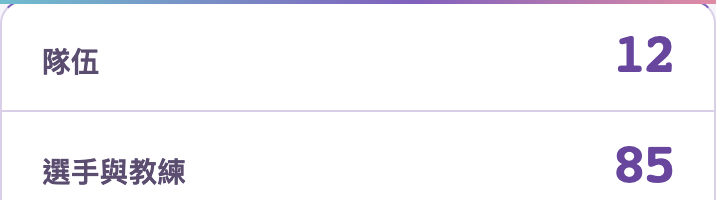
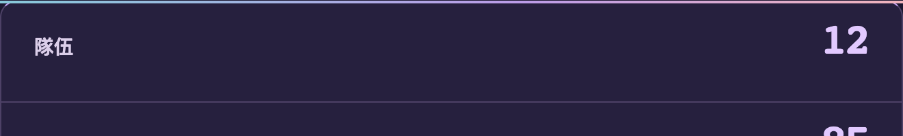
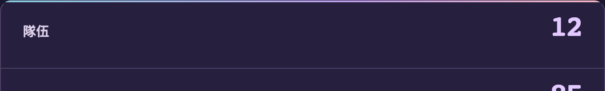

# S5 statistic-panel accent line

2026-10-29 Asia/Taipei. Follow-up to the registered S5 Prism Overture appearance (#345), based on main `3ced64d645eccf43752bfa4bd01867aa3e249db0`.

The organizer's screenshot shows the thin gradient accent extending across the panel's rounded top corners. The old `::before` is a separate rectangular strip positioned over the border. The fix paints the same 2px cyan/violet/peach gradient in the panel's border-box background, so the browser clips it to the existing 12px radius. No overflow clipping is added to descendants.

Forced colours remove the decorative image and restore a visible system-colour top border. Labels, values, spacing, artwork, result approval/publication and appearance preferences are unchanged.

## Visual comparison

Real S5 page crops at 2×, showing the top 100 CSS pixels of the statistic panel. Before uses the dedicated development preview; after uses the production build. The local fixture uses the committed S5 sources and preserves their review statuses; these are not production database screenshots.

Mobile light, 390px:

Desktop dark, 1440px:

## Verification

- [Before state](before.json) records the original pseudo-element, radius and labels.
- [Final browser report](verification.json) binds the stylesheet hash and build ID. It checks three locales × light/dark × 320/390/768/1440px, unchanged statistics, no page overflow, and sampled top-corner pixels matching the page background while the centre accent remains visible.
- Forced-colour cases verify removal of the gradient and retention of the top border. The default appearance is checked separately.
- Existing S5 desktop/mobile browser tests verify selection, SSR, complete artwork, narrow layouts and reduced motion. No implementation-mirroring test is added for this isolated decoration change.

Node.js24.22.1 locked install, lint/types and production build passed. Complete unit/integration checks: 185 files, 1511 passed, 1 skipped; production dependency audit: 0 vulnerabilities.

Three locales × light/dark × four widths: 24 UI cases and 24 Axe AA scans passed with no violations, overflow or page errors. Corner pixels match the page background, the centre accent remains visible, and the five statistic values remain unchanged. Four forced-colour cases and the unchanged default appearance passed. Existing desktop/mobile S5 E2E: 4 passed. Full functional/header/remote or Safari acceptance is not implied.

## Environment

A new temporary PostgreSQL cluster could not start because the host exhausted shared-memory IDs. Verification therefore creates separate task-owned databases on the existing loopback-only temporary test cluster at port 54397: `oclr_s5_panel_preview_test_20261029`, `oclr_s5_panel_unit_test_20261029` and `oclr_s5_panel_browser_test_20261029`. No other database, cluster configuration, kernel setting or production service is changed.
